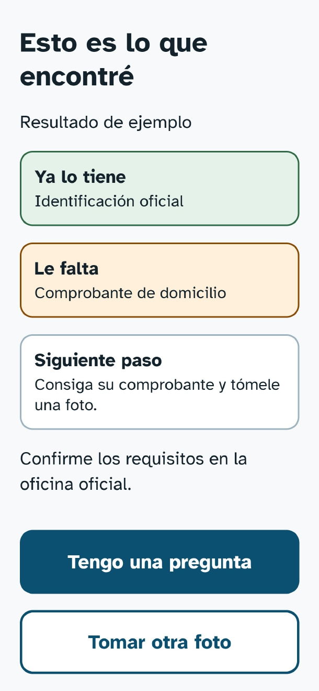

# Abuelo Guía

> **Equipo:** UMIZOOMI | **Campus:** Mérida UVM | **Integrantes:** Emiliano Perez, Rodrigo Ferrer, Alan Jimenez, Jonathan Alvarez

## 📱 App demostrable

**[Descargar Abuelo Guía para Android (APK)](https://github.com/EmilianoPerezz/Abuelo-Guia/releases/latest/download/AbueloGuia.apk)** · [Ver todas las versiones](https://github.com/EmilianoPerezz/Abuelo-Guia/releases)

Requiere Android 7 o superior y conexión a internet. Las instrucciones de instalación están en el [Manual de usuario](#5-manual-de-usuario).

---

## 1. Resumen ejecutivo

Abuelo Guía es una aplicación móvil con asistente de voz diseñada para ayudar a adultos mayores a realizar trámites, como el de su pensión. El usuario toma una foto de su documento y la aplicación le explica, con lenguaje sencillo, qué hace falta y cuál es el siguiente paso. Busca reducir la confusión, evitar vueltas innecesarias y disminuir la dependencia de terceros frente a trámites con textos complejos o información dispersa, apoyando a personas mayores con dificultades para comprender procedimientos o navegar interfaces cargadas de texto.

---

## 2. Boceto y concepto

### Problema detectado
La información sobre trámites suele ser confusa, estar dispersa y emplear lenguaje difícil. Muchos adultos mayores no saben qué documentos requieren, lo que puede provocar traslados innecesarios, dependencia de otras personas o perder el acceso a un apoyo.

### Propuesta de solución
Una aplicación móvil apoyada en un asistente de voz donde el usuario captura una fotografía de su documento y recibe una explicación clara y sencilla sobre qué falta y cuál es el siguiente paso a seguir.

### Alineación con los Objetivos de Desarrollo Sostenible (ODS)
- **ODS 10 (Reducción de las desigualdades):** Facilita el acceso a trámites y derechos a quienes enfrentan barreras de lectura o tecnología.
- **ODS 11 (Ciudades y comunidades sostenibles):** Favorece comunidades más inclusivas, con servicios más accesibles para las personas mayores, y puede evitar traslados innecesarios.

### Público objetivo
Adultos mayores con dificultades para entender trámites o usar aplicaciones con mucho texto.

### Qué la hace diferente
- **No hay que leer la convocatoria:** el usuario solo toma una foto y la app le dice qué documento es y si sirve.
- **Lista personal que se va marcando:** cada foto válida marca un requisito, así la persona sabe en todo momento cuánto le falta.
- **Pensada para voz:** todo se lee en voz alta y las preguntas se hacen hablando; escribir es opcional.
- **Respuestas acotadas al trámite real:** Gemini solo usa la lista oficial incluida en la app, en lugar de responder como un chat genérico.

### Boceto / diseño
| Inicio | Tomar foto | Qué falta | Preguntar |
|:---:|:---:|:---:|:---:|
|  |  |  |  |

[Ver carpeta del boceto](boceto/): Inicio, Tomar foto, Qué falta y Preguntar con voz. Los resultados que muestra son de ejemplo.

---

## 3. Documentación funcional

Funciones del MVP (trámite: Pensión para el Bienestar de las Personas Adultas Mayores):

- **Foto del documento:** el usuario toma una foto con la cámara o elige una foto guardada. Gemini identifica qué documento es y si sirve (vigente, legible y, en el comprobante de domicilio, de máximo 6 meses).
- **Lista que se va marcando:** cada foto válida marca un requisito como "Ya lo tiene". La lista oficial incluida en la app es: identificación oficial vigente, CURP, acta de nacimiento y comprobante de domicilio (máximo 6 meses). Además recuerda llevar los teléfonos de contacto.
- **Explicación en lenguaje sencillo:** muestra el siguiente paso con frases cortas y letra grande, y lo lee en voz alta automáticamente.
- **Asistente de voz:** el usuario toca el micrófono, hace su pregunta y escucha la respuesta. Gemini conoce qué documentos ya tiene y cuáles le faltan. También hay preguntas sugeridas y la opción "Prefiero escribir".

La aplicación orienta, pero no valida documentos oficialmente.

Fuente de los requisitos: convocatoria oficial de Programas para el Bienestar (gob.mx/bienestar).

---

## 4. Documentación técnica

### Arquitectura general
1. La app captura la foto o la pregunta por voz.
2. La app envía a Gemini la imagen o el texto, junto con la lista de requisitos incluida en la app.
3. Gemini devuelve una explicación sencilla.
4. La app la muestra en pantalla y la lee en voz alta.

### Stack tecnológico
- **Aplicación móvil:** Flutter (Dart), desarrollada en Android Studio.
- **Cámara:** paquete `image_picker`.
- **Voz:** paquetes `speech_to_text` (escuchar) y `flutter_tts` (leer en voz alta).
- **Datos:** lista de requisitos incluida en la app, sin base de datos propia.
- **Conexión:** paquete `http`.
- **Inteligencia Artificial:** Google Gemini API (REST `generateContent`). Modelo: `gemini-3.5-flash-lite` (si está saturado, la app reintenta con `gemini-3.8-flash`).

### Integración de Gemini
Gemini interpreta la foto del documento, la compara con la lista de requisitos, explica qué falta y cuál es el siguiente paso, y responde las preguntas del usuario. La voz se convierte a texto en el celular antes de enviarse. Para las fotos, Gemini responde en JSON (`requisito`, `documento`, `sirve`, `explicacion`, `siguiente_paso`) y la app marca la lista con esa respuesta. Las fotos solo se envían a Gemini para revisarlas; la app no las guarda.

### Estructura del código
```
lib/
├── main.dart                 Arranque de la app y tema
├── data/requisitos.dart      Lista oficial de requisitos del trámite
├── services/
│   ├── gemini_service.dart   Llamadas a Gemini (revisar foto y responder preguntas)
│   ├── tramite.dart          Estado en memoria: lista marcada y conversación
│   └── voz_service.dart      Voz a texto y lectura en voz alta
├── screens/                  Inicio, Tomar foto, Resultado y Preguntar
├── theme/                    Colores y tamaños de letra
└── widgets/                  Botones, tarjetas y botón de voz reutilizables
test/widget_test.dart         Pruebas de la pantalla de inicio y de la lista
```

### Cómo ejecutar el proyecto (desarrolladores)
1. Instale Flutter y Android Studio. En Windows active el **Modo de desarrollador** (lo pide Flutter para los plugins).
2. Cree una clave de Gemini en Google AI Studio.
3. Copie `.env.example` como `.env` y pegue su clave. `.env` está en `.gitignore` y no se sube a GitHub.
4. Ejecute:
```
flutter pub get
flutter run --dart-define-from-file=.env
```
5. Para generar el APK: `flutter build apk --release --dart-define-from-file=.env`

En Android Studio agregue `--dart-define-from-file=.env` en *Run > Edit Configurations > Additional run args*.

---

## 5. Manual de usuario

Esta guía está pensada para personas que usan la aplicación por primera vez.

### Instalación o acceso
1. Desde su teléfono Android, toque [Descargar Abuelo Guía](https://github.com/EmilianoPerezz/Abuelo-Guia/releases/latest/download/AbueloGuia.apk).
2. Abra el archivo descargado. Si el teléfono lo pide, permita **instalar apps desconocidas**. Si aparece Play Protect, toque **Más detalles → Instalar de todas formas** (aparece porque la app no viene de la Play Store).
3. Cuando la aplicación lo pida, permita el uso de la cámara y del micrófono.
4. Necesita conexión a internet.

### Primeros pasos y uso diario
1. Abra la aplicación.
2. Toque **Tomar foto de mi documento** y ponga la hoja sobre una mesa, con buena luz.
3. Lea qué documentos ya tiene, cuál le falta y qué hacer después.
4. La app le lee el resultado en voz alta. Toque **Escuchar** para oírlo otra vez.
5. Toque **Tomar foto de otro documento** para seguir completando su lista.
6. Si tiene una duda, toque **Tengo una pregunta** o **Hablar con el asistente**, toque el micrófono y hable.
7. Toque **Escuchar respuesta** para oírla otra vez.
8. Confirme los requisitos en su Módulo de Bienestar.

---

## 6. Accesibilidad e impacto

### Características de accesibilidad e inclusión
- Apoyo mediante asistente de voz para reducir la carga de lectura.
- Explicaciones en lenguaje sencillo orientadas a usuarios con dificultades para entender trámites o usar aplicaciones con mucho texto.
- Diseño con letra grande, botones grandes y alto contraste.
- Pocas opciones por pantalla.

### Impacto esperado
Facilitar que los adultos mayores comprendan y avancen en trámites esenciales como su pensión con mayor autonomía, reduciendo trámites incompletos, dependencia de terceros y traslados innecesarios en la comunidad.

### Privacidad y límites
- Las fotos solo se envían a Gemini para revisarlas; la app no las guarda ni tiene base de datos.
- Se le indica a Gemini que no repita datos personales como números de CURP o direcciones.
- La app orienta, pero no sustituye la revisión oficial: siempre recomienda confirmar en el Módulo de Bienestar.
- Los teléfonos de contacto no se pueden revisar con foto; la app los muestra como recordatorio.
- Para demostraciones se recomienda usar documentos ficticios o con los datos tapados.